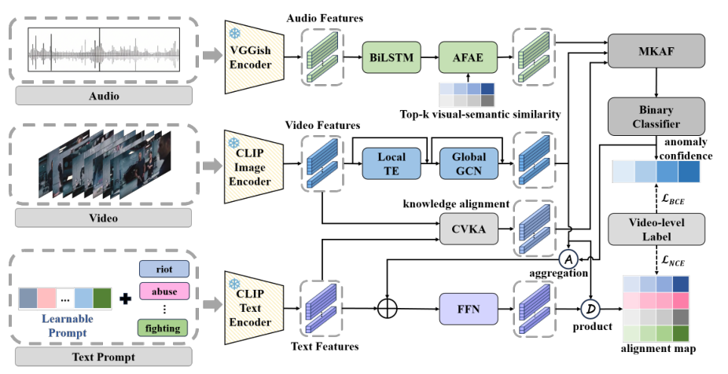

# CMHKF · ACL 2025

**Cross-Modality Heterogeneous Knowledge Fusion for Weakly Supervised Video Anomaly Detection**

[](https://aclanthology.org/2025.acl-long.1524/) [](https://aclanthology.org/2025.acl-long.1524.pdf) [](LICENSE)

CMHKF is a framework for weakly supervised video anomaly detection. It combines video, audio, and text information to detect and localize anomalous events using video-level labels during training.



*Framework overview from Figure 1 of the [ACL 2025 paper](https://aclanthology.org/2025.acl-long.1524/), licensed under [CC BY 4.0](https://creativecommons.org/licenses/by/4.0/).*

The framework uses cross-modality video-text knowledge alignment (CVKA), audio modality feature adaptive extraction (AFAE), and multi-modality knowledge adaptive fusion (MKAF).

## Installation

The commands below use Python 3.8 and CUDA 11.3 on Linux. A CUDA-enabled NVIDIA GPU is required. For other CUDA versions, consult the [PyTorch installation guide](https://pytorch.org/get-started/previous-versions/).

```bash
git clone https://github.com/ssp-seven/CMHKF.git
cd CMHKF
conda create -n cmhkf python=3.8 -y
conda activate cmhkf

python -m pip install setuptools==68.2.2
python -m pip install torch==1.10.2+cu113 torchvision==0.11.3+cu113 \
  --extra-index-url https://download.pytorch.org/whl/cu113
python -m pip install numpy==1.23.5 pandas==1.5.3 scipy==1.10.1 \
  scikit-learn==1.3.2 ftfy==6.2.0 regex==2024.5.15 \
  tqdm==4.66.4 Pillow==9.3.0
```

The model uses the CLIP implementation in `src/clip/`. The first run downloads the CLIP ViT-B/16 weights to `~/.cache/clip/`. The supplied `src/requirements.txt` records the original environment and includes machine-specific paths; use the commands above for a portable setup.

## Data preparation

Download [XD-Violence](https://roc-ng.github.io/XD-Violence/) and prepare temporally aligned NumPy features for each video:

- CLIP ViT-B/16 video features with shape `[T, 512]`.
- VGGish audio features with shape `[T, 128]`.

Here `T` is the number of time steps. Evaluation expands each time step into 16 frames, so align the features and annotations accordingly. The repository does not provide a complete batch feature-extraction pipeline.

Update the `path` column in the following CSV files to point to your local features:

| Split | Video features | Audio features |
| --- | --- | --- |
| Train | `list/xd_CLIP_rgb.csv` | `list/xd_audio.csv` |
| Test | `list/xd_CLIP_rgbtest.csv` | `list/xd_audio_test.csv` |

Each CSV uses a `path,label` header. Video and audio entries are paired **by row**, so keep their order aligned. The training list contains multiple visual crops per video with the corresponding audio path repeated. Keep the test list in the same order as the evaluation annotations.

After updating the paths, run the following from the repository root to generate the frame-level and segment-level ground truth needed for both training and evaluation:

<details>
<summary>Generate evaluation annotations</summary>

```bash
python - <<'PY'
import csv
import re
from pathlib import Path
import numpy as np

root = Path('list')

def read_annotations(filename):
    result = {}
    for line in (root / filename).read_text().splitlines():
        fields = line.split()
        if fields:
            name = fields[0]
            if name.endswith('.mp4'):
                name = name[:-4]
            result[name] = fields[1:]
    return result

binary = read_annotations('annotations.txt')
multiclass = read_annotations('annotations_multiclasses.txt')
frames, segments, labels = [], [], []
with (root / 'xd_CLIP_rgbtest.csv').open(newline='') as f:
    for row in csv.DictReader(f):
        name = re.sub(r'__\d+\.npy$', '', Path(row['path']).name)
        frame_count = np.load(row['path'], mmap_mode='r').shape[0] * 16
        gt = np.zeros(frame_count, dtype=np.float32)
        if row['label'] == 'A':
            video_segments, video_labels = [[0, frame_count]], ['A']
        else:
            bounds = list(map(int, binary[name]))
            for start, end in zip(bounds[::2], bounds[1::2]):
                gt[start:end] = 1
            events = multiclass[name]
            video_segments = [[int(events[i + 1]), int(events[i + 2])]
                              for i in range(0, len(events), 3)]
            video_labels = events[::3]
        frames.append(gt)
        segments.append(video_segments)
        labels.append(video_labels)

np.save(root / 'gt_xd.npy', np.concatenate(frames))
np.save(root / 'gt_segment.npy', np.array(segments, dtype=object))
np.save(root / 'gt_label.npy', np.array(labels, dtype=object))
print(f'Generated annotations for {len(segments)} videos.')
PY
```

</details>

This creates `list/gt_xd.npy`, `list/gt_segment.npy`, and `list/gt_label.npy` in test-list order.

## Training

Run the following from the repository root:

```bash
cd src
mkdir -p ../model

CUDA_VISIBLE_DEVICES=0 python train.py \
  --train-list ../list/xd_CLIP_rgb.csv \
  --train-audio-list ../list/xd_audio.csv \
  --test-list ../list/xd_CLIP_rgbtest.csv \
  --test-audio-list ../list/xd_audio_test.csv \
  --gt-path ../list/gt_xd.npy \
  --gt-segment-path ../list/gt_segment.npy \
  --gt-label-path ../list/gt_label.npy \
  --model-path ../model/model.pth \
  --checkpoint-path ../model/checkpoint.pth
```

The training script periodically evaluates the model and saves the best model weights to `model/model.pth`. See `src/option.py` for available options and defaults.

## Evaluation

After training, run the following from the `src/` directory:

```bash
CUDA_VISIBLE_DEVICES=0 python test.py \
  --model-path ../model/model.pth \
  --test-list ../list/xd_CLIP_rgbtest.csv \
  --test-audio-list ../list/xd_audio_test.csv \
  --gt-path ../list/gt_xd.npy \
  --gt-segment-path ../list/gt_segment.npy \
  --gt-label-path ../list/gt_label.npy
```

The script reports frame-level detection and temporal localization metrics.

## Citation

If you use this work, please cite:

```bibtex
@inproceedings{wang-etal-2025-cmhkf,
  title = "{CMHKF}: Cross-Modality Heterogeneous Knowledge Fusion for Weakly Supervised Video Anomaly Detection",
  author = "Wang, Guohua and Song, Shengping and He, Wuchun and Zheng, Yongsen",
  booktitle = "Proceedings of the 63rd Annual Meeting of the Association for Computational Linguistics (Volume 1: Long Papers)",
  month = jul,
  year = "2025",
  address = "Vienna, Austria",
  publisher = "Association for Computational Linguistics",
  pages = "31594--31607",
  url = "https://aclanthology.org/2025.acl-long.1524/",
  doi = "10.18653/v1/2025.acl-long.1524"
}
```

## Acknowledgments and license

This project builds on [CLIP](https://github.com/openai/CLIP), [VadCLIP](https://github.com/nwpu-zxr/VadCLIP), and [XD-Violence](https://roc-ng.github.io/XD-Violence/). The code is released under the [Apache License 2.0](LICENSE). Dataset and pretrained model terms apply separately.
