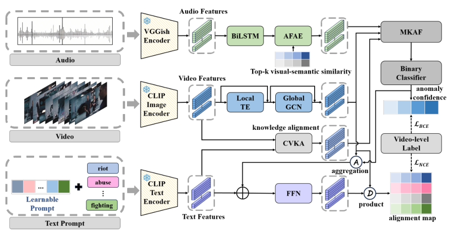

# CMHKF · ACL 2025

**Cross-Modality Heterogeneous Knowledge Fusion for Weakly Supervised Video Anomaly Detection**

Guohua Wang\*, Shengping Song\*, Wuchun He, Yongsen Zheng<br>South China Agricultural University · Nanyang Technological University<br>\* Equal contribution

[](https://aclanthology.org/2025.acl-long.1524/) [](https://aclanthology.org/2025.acl-long.1524.pdf) [](LICENSE)

CMHKF 面向**弱监督视频异常检测（WSVAD）**：训练时仅使用视频级标签，测试时定位异常发生的时间，并识别异常类别。模型融合视频、音频和类别文本中的互补信息，同时支持正常/异常检测与细粒度异常定位。

本仓库提供 CMHKF 模型及 XD-Violence 训练、评估代码。运行前需要自行准备预提取特征和评估标注；仓库未附带特征文件及训练好的 CMHKF 权重。

## 方法概览



*图源：论文 Figure 1，Guohua Wang et al., ACL 2025，见[论文](https://aclanthology.org/2025.acl-long.1524/)。*

- **视频时序建模**：使用 CLIP ViT-B/16 视觉特征，通过 Local Transformer 和 Global GCN 建模局部及全局时序关系。
- **CVKA（Cross-Modality Video-Text Knowledge Alignment）**：选择与视频最相关的类别文本，将文本语义对齐到视频时间维度。
- **AFAE（Audio Modality Feature Adaptive Extraction）**：结合 BiLSTM 与视频-文本相关性，提取音频中的时序显著信息。
- **MKAF（Multi-Modality Knowledge Adaptive Fusion）**：融合视频、音频及文本特征，用于异常评分和视频-文本对齐。

训练目标由二分类 MIL 损失、多分类 MIL 对齐损失、正常与异常文本对比损失、异常类别间文本对比损失组成；后两项在代码中的权重分别为 `1e-3`、`1e-4`。

## 论文结果

以下为**论文报告结果**，并非本 README 的复现实测。XD-Violence 数据来自论文 Table 1、2；UCF-Crime 数据来自附录 Table 8、9。

| 数据集 | 配置 | 模态 | 帧级指标（%） | 平均 mAP（%） |
| --- | --- | --- | --- | --- |
| XD-Violence | CMHKF light | 视频 + 音频 + 文本 | AP 84.65 | 24.86 |
| XD-Violence | CMHKF full | 视频 + 音频 + 文本 | **AP 86.57** | **26.70** |
| UCF-Crime | CMHKF | 视频 + 文本 | AUC 88.24 | 9.54 |

XD-Violence 完整模型的细粒度定位结果：

| mAP@IoU 0.1 | 0.2 | 0.3 | 0.4 | 0.5 | 平均 |
| --- | --- | --- | --- | --- | --- |
| 38.31 | 32.12 | 25.68 | 20.93 | 16.47 | **26.70** |

平均 mAP 为 IoU 阈值 `0.1, 0.2, 0.3, 0.4, 0.5` 下 mAP 的均值。当前 `train.py`、`test.py` 使用 XD-Violence 的七类配置；UCF-Crime 数据清单及辅助代码虽已包含，但不能直接通过切换清单复现附录实验。

## 环境配置

建议使用 **Linux + NVIDIA CUDA GPU**。论文实验使用 NVIDIA RTX 3090；当前 `DistanceAdj` 在实现中直接使用 CUDA，因此默认代码不能直接在 CPU 或 Apple MPS 上运行。

以下给出与仓库主要依赖版本对应的 Python 3.8、CUDA 11.3 安装示例。其他 CUDA 环境请参照 [PyTorch 历史版本安装说明](https://pytorch.org/get-started/previous-versions/)选择匹配版本。

```bash
git clone https://github.com/ssp-seven/CMHKF.git
cd CMHKF

conda create -n cmhkf python=3.8 -y
conda activate cmhkf

python -m pip install setuptools==68.2.2
python -m pip install torch==1.10.2+cu113 torchvision==0.11.3+cu113 \
  --extra-index-url https://download.pytorch.org/whl/cu113
python -m pip install numpy==1.23.5 pandas==1.5.3 scipy==1.10.1 \
  scikit-learn==1.3.2 ftfy==6.2.0 regex==2024.5.15 \
  tqdm==4.66.4 Pillow==9.3.0
```

上述依赖覆盖当前训练、评估入口的直接导入。`src/requirements.txt` 是较完整的原实验环境记录，其中包含 `file:///croot/...` 本地安装引用及额外工具依赖，不适合作为跨机器直接安装清单。

模型使用仓库自带的 `src/clip/` 实现，其中包含项目使用的文本编码接口。首次构建模型会下载 CLIP ViT-B/16 预训练权重，默认缓存至 `~/.cache/clip/`；请保留这份本地实现。

## 数据准备

### 1. 准备视频和音频特征

数据集及原始资源入口：[XD-Violence 官方项目页](https://roc-ng.github.io/XD-Violence/)。该页面的特征资源不等同于本项目所需的 CLIP 特征，请核对特征类型与维度。

| 输入 | 提取方式 | 单个 `.npy` 的形状 |
| --- | --- | --- |
| 视频特征 | CLIP ViT-B/16 | `[T, 512]` |
| 音频特征 | VGGish | `[T, 128]` |
| 类别文本 | 模型内使用 CLIP 文本编码器和可学习提示生成 | 无需单独准备文件 |

`T` 为时间步数，视频和音频特征需要按时间对齐，建议保存为 `float32`。评估代码将每个时间步的预测重复 16 次得到帧级分数，因此特征与标注必须采用相应的 16 帧时间步约定。仓库提供裁剪辅助函数 `src/utils/crop.py`，尚未提供从原始视频批量提取全部所需特征的完整流水线。

### 2. 更新特征清单中的路径

仓库包含以下 XD-Violence CSV 清单，每个文件均使用 `path,label` 表头：

| 用途 | 视频特征清单 | 音频特征清单 | 行数 |
| --- | --- | --- | --- |
| 训练 | `list/xd_CLIP_rgb.csv` | `list/xd_audio.csv` | 39,540 |
| 测试 | `list/xd_CLIP_rgbtest.csv` | `list/xd_audio_test.csv` | 800 |

训练清单包含每个视频的 10 个视觉裁剪条目，相应音频路径会重复。**视频和音频按 CSV 行号配对**，修改路径时应保留行顺序；测试清单与所有评估标注也必须保持同一顺序。现有清单中的 `/media/...` 为原实验环境绝对路径，需要替换为本地特征位置。

视频清单示例：

```csv
path,label
/data/XDTestClipFeatures/example_label_B2-0-0__5.npy,B2-0-0
```

对应音频清单示例：

```csv
path,label
/data/vggish-features/test/example_label_B2-0-0__vggish.npy,B2-0-0
```

以上仅展示格式，文件名需与实际数据一致。类别编码如下，多标签使用 `-` 连接；`0` 为占位符，不参与类别编码。

| 编码 | 类别 | 编码 | 类别 |
| --- | --- | --- | --- |
| `A` | Normal | `B1` | Fighting |
| `B2` | Shooting | `B4` | Riot |
| `B5` | Abuse | `B6` | Car accident |
| `G` | Explosion | | |

### 3. 生成评估标注

训练过程会调用测试集评估，因此首次训练前也需要准备：

- `list/gt_xd.npy`：按测试清单顺序拼接的帧级正常/异常标注。
- `list/gt_segment.npy`：逐视频的事件起止帧列表。
- `list/gt_label.npy`：逐视频的事件类别列表，与事件区间一一对应。

现有 `make_gt_xd.py`、`make_gt_mAP_xd.py` 只处理 `__0.npy`，而仓库测试清单使用 `__5.npy`。下面的替代命令直接按清单逐行生成标注，兼容不同裁剪编号及部分标注文件名保留 `.mp4` 后缀的情况。**先完成特征路径替换，再在仓库根目录执行。**

<details>
<summary>展开标注生成命令</summary>

```bash
python - <<'PY'
import csv
import re
from pathlib import Path
import numpy as np

root = Path('list')

def read_annotations(filename):
    result = {}
    for line in (root / filename).read_text().splitlines():
        fields = line.split()
        if fields:
            name = fields[0]
            if name.endswith('.mp4'):
                name = name[:-4]
            result[name] = fields[1:]
    return result

binary = read_annotations('annotations.txt')
multiclass = read_annotations('annotations_multiclasses.txt')
frames, segments, labels = [], [], []
with (root / 'xd_CLIP_rgbtest.csv').open(newline='') as f:
    for row in csv.DictReader(f):
        name = re.sub(r'__\d+\.npy$', '', Path(row['path']).name)
        frame_count = np.load(row['path'], mmap_mode='r').shape[0] * 16
        gt = np.zeros(frame_count, dtype=np.float32)
        if row['label'] == 'A':
            video_segments, video_labels = [[0, frame_count]], ['A']
        else:
            bounds = list(map(int, binary[name]))
            for start, end in zip(bounds[::2], bounds[1::2]):
                gt[start:end] = 1
            events = multiclass[name]
            video_segments = [[int(events[i + 1]), int(events[i + 2])]
                              for i in range(0, len(events), 3)]
            video_labels = events[::3]
        frames.append(gt)
        segments.append(video_segments)
        labels.append(video_labels)

np.save(root / 'gt_xd.npy', np.concatenate(frames))
np.save(root / 'gt_segment.npy', np.array(segments, dtype=object))
np.save(root / 'gt_label.npy', np.array(labels, dtype=object))
print(f'Generated annotations for {len(segments)} videos.')
PY
```

</details>

## 训练与评估

以下命令均在 **`src/` 目录**运行，以匹配默认相对路径。`--gt-path` 显式指向上一步生成的 `gt_xd.npy`；代码中的默认文件名为 `gt.npy`。

### 训练

```bash
cd src
mkdir -p ../model

CUDA_VISIBLE_DEVICES=0 python train.py \
  --train-list ../list/xd_CLIP_rgb.csv \
  --train-audio-list ../list/xd_audio.csv \
  --test-list ../list/xd_CLIP_rgbtest.csv \
  --test-audio-list ../list/xd_audio_test.csv \
  --gt-path ../list/gt_xd.npy \
  --gt-segment-path ../list/gt_segment.npy \
  --gt-label-path ../list/gt_label.npy \
  --model-path ../model/model.pth \
  --checkpoint-path ../model/checkpoint.pth \
  --batch-size 64 \
  --max-epoch 10
```

默认训练参数来自 `src/option.py`：

| 参数 | 默认值 | 含义 |
| --- | --- | --- |
| `--seed` | `234` | 随机种子 |
| `--batch-size` | `64` | 训练批大小 |
| `--max-epoch` | `10` | 训练轮数 |
| `--visual-length` | `256` | 每个输入序列的时间步数 |
| `--attn-window` | `64` | 局部 Transformer 窗口 |
| `--classes-num` | `7` | 正常类与六种异常类 |
| `--lr` | `1e-5` | AdamW 学习率 |
| `--prompt-prefix` / `--prompt-postfix` | `10` / `10` | 可学习提示长度 |

MKAF 内部包含固定的 256 维时间映射，修改 `--visual-length` 时需要同步修改模型。训练中间评估后，按 `AP2` 的提升保存 `model.pth` 和 `checkpoint.pth`；权重不是在每个 epoch 末尾自动保存。更改批大小或数据量时，请检查 `train.py` 中 `step % 4800` 的评估触发条件。

### 评估

获得训练生成的 `model.pth` 后，在 `src/` 目录执行：

```bash
CUDA_VISIBLE_DEVICES=0 python test.py \
  --model-path ../model/model.pth \
  --test-list ../list/xd_CLIP_rgbtest.csv \
  --test-audio-list ../list/xd_audio_test.csv \
  --gt-path ../list/gt_xd.npy \
  --gt-segment-path ../list/gt_segment.npy \
  --gt-label-path ../list/gt_label.npy
```

输出包括两个分支的帧级 `AUC1/AP1`、`AUC2/AP2`，以及各 IoU 阈值下的 mAP 和平均 mAP。`AP1` 来自二分类分支，`AP2` 来自 `1 - P(normal)` 的视频-文本对齐分支。日志中的 AP/AUC 为 `[0, 1]` 小数，mAP 按百分数打印。

### 当前实现说明

- **音频窗口**：论文报告最优窗口宽度 `W=5`（`w=2`）；当前 `AudioSaliency.py` 使用 `range(1, 4)`，左右各扩展 3 个时间步，对应 `W=7`。严格对齐论文配置时需要调整该实现。
- **断点续训**：当前保存的 checkpoint 未包含恢复分支读取的 `map` 字段，且没有保存调度器状态。使用 `--use-checkpoint` 前需完善恢复逻辑；常规训练命令不启用该选项。
- **学习率参数**：`--lr` 等部分参数未声明 `argparse` 类型，直接从命令行覆盖可能得到字符串。修改这些参数时需同步补充解析类型，或在 `option.py` 中修改数值默认值。

## 项目结构

```text
CMHKF/
├── README.md
├── LICENSE
├── docs/images/cmhkf-framework.png
├── list/                      # 特征清单、文本标注及标注生成辅助脚本
└── src/
    ├── train.py               # MIL 训练、损失函数及权重保存
    ├── test.py                # 帧级检测及多类别时序定位评估
    ├── option.py              # 命令行参数与默认配置
    ├── model.py               # CMHKF 主模型
    ├── TextVideoAligner.py    # CVKA
    ├── AudioSaliency.py       # AFAE
    ├── AVTfusion.py           # MKAF
    ├── BiLSTM.py              # 音频时序建模
    ├── clip/                 # 项目使用的 CLIP 实现
    ├── utils/                # 数据加载、特征处理、图层和评估工具
    └── requirements.txt      # 原实验环境依赖记录
```

`model/` 在运行训练命令时创建。特征数据需另行准备；生成的 `.npy` 标注写入 `list/`。

## 引用

如果本项目对你的研究有帮助，请引用：

```bibtex
@inproceedings{wang-etal-2025-cmhkf,
  title = "{CMHKF}: Cross-Modality Heterogeneous Knowledge Fusion for Weakly Supervised Video Anomaly Detection",
  author = "Wang, Guohua and Song, Shengping and He, Wuchun and Zheng, Yongsen",
  booktitle = "Proceedings of the 63rd Annual Meeting of the Association for Computational Linguistics (Volume 1: Long Papers)",
  month = jul,
  year = "2025",
  address = "Vienna, Austria",
  publisher = "Association for Computational Linguistics",
  pages = "31594--31607",
  url = "https://aclanthology.org/2025.acl-long.1524/",
  doi = "10.18653/v1/2025.acl-long.1524"
}
```

## 致谢与许可

感谢 [CLIP](https://github.com/openai/CLIP)、[VadCLIP](https://github.com/nwpu-zxr/VadCLIP) 和 [XD-Violence](https://roc-ng.github.io/XD-Violence/) 提供的研究基础与资源。

本仓库采用 [Apache License 2.0](LICENSE)。论文架构图摘自原论文，按 [ACL Anthology 的 CC BY 4.0 条款](https://aclanthology.org/faq/copyright/)注明来源；数据集及外部预训练模型遵循各自的许可与使用条款。
